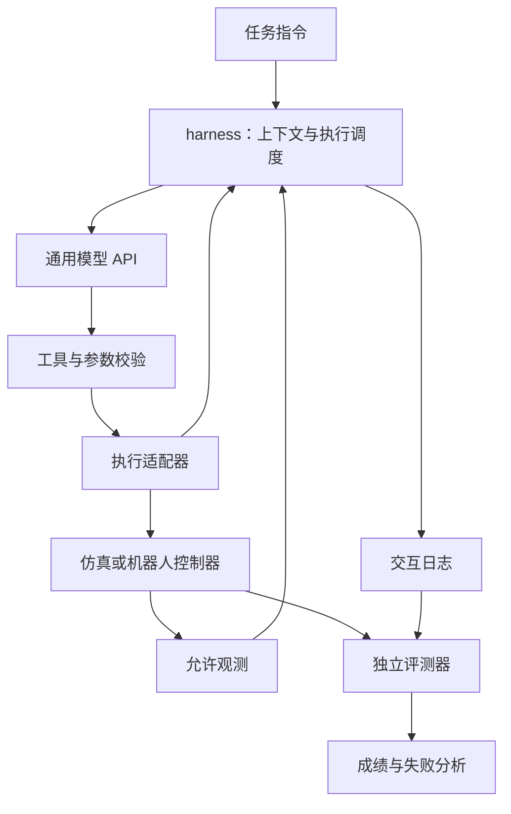

# 通用大模型机器狗能力评测：harness 初步实现方案

更新日期：2026-10-21

**当前状态：设计阶段。本文定义拟实现的基线、接口和实验协议，目录结构、配置与伪代码尚未实现，不能直接运行。**

项目目标是搭建一个固定、可记录、可替换模型的 harness，用于测试通用大模型通过 API 驱动机器狗完成任务的能力。先得到可复现的普通 Agent 基线，再研究任务规划、完成检查和外部记忆模块的增益。模型参数保持不变，不新增或训练动作 Head。

`harness` 指模型外部的执行与评测支撑程序。前期讨论中的 `hardness` 在本项目中统一写作 `harness`。

## 1. 研究问题与基线定义

优先回答：**在相同观测、动作工具、控制器和预算下，不同通用大模型能否理解指令、选择合适动作、利用反馈修正错误，并完成连续任务？**

初期结论限定为“模型在指定感知与执行条件下的任务表现”。感知、导航、运动控制对成绩都有影响，不能把整套系统的成功率全部归因于模型。

### 1.1 基础版本 H0

- 输入用户指令、当前允许观测和固定窗口的近期交互历史。
- 模型每轮选择一个工具调用，或明确声明成功/无法继续。
- harness 校验请求、执行工具、返回结果并保存日志。
- 保留基本执行状态和有界上下文，不设置独立规划 Agent、子任务计划表或可检索的长期记忆。
- 模型可以在其调用中自行推理；“无独立规划模块”不等于“模型不能规划”。

| 部件 | H0 中的职责 | 应避免的混淆 |
| --- | --- | --- |
| 通用模型 | 理解指令、选择下一步、根据允许的反馈调整决策 | 把预先写好的任务答案塞进提示词 |
| harness | 消息组织、参数校验、调度、超时、上下文管理、日志 | 暗中替模型拆任务、选路径、补做遗漏步骤 |
| 感知适配器 | 输出当前协议允许的图像或结构化观测 | 将隐藏目标位置、全局地图真值直接送给模型 |
| 执行适配器 | 将工具请求转换为已有技能或控制接口 | 不披露自动搜索、自动绕障等额外能力 |
| 本地保护 | 执行固定的限幅、停止、动作互斥等规则 | 依赖云端 API 实时维持机器人安全运行 |
| 独立评测器 | 根据预先定义的标准记录任务得分 | 用模型自述“完成”作为最终成绩 |

### 1.2 平台与已知依赖

沿用 CerebVLA 所使用的平台方向：先在相关仿真环境验证，再考虑 Unitree Go2 实机。本地论文描述了 QUARD 仿真与 Go2 实验，但**当前工作区尚未接入环境、SDK、控制器或模型 API**。平台相同不意味着已经取得相同代码、权重和全部任务接口。[本地论文](../../QUAR_VLA_ICRA_2027.pdf)

接入前确认：环境版本、传感器接口、允许的动作类型、底层控制器、重置方法和任务判定规则。首版不要求复现完整 CerebVLA，也不预设某个现成 VLA 模型已成为执行器。

## 2. 先固定观测与动作范围

这是基线设计中优先级最高的决定。接口提供多少能力，会直接改变“到底在测试什么”。

### 2.1 观测协议

建议分开报告两类实验，不把它们混成一张排名表。

| 协议 | 输入 | 主要用途 |
| --- | --- | --- |
| S：结构化观测 | 固定感知前端输出的目标、相对位置、机器人状态 | 先跑通系统，比较推理、工具调用和任务执行能力 |
| V：视觉观测 | 相同相机图像、允许的本体状态和工具反馈 | 在具备相应输入能力的模型之间比较视觉与决策表现 |

S 协议中，所有模型共享同一感知前端，并记录其版本；如果直接使用仿真真值，应标为 `oracle_debug`，只作调试或单独的上界实验。V 协议固定图像数量、采样时刻、分辨率和历史窗口。具体模型是否支持图像与工具调用，按该版本实际接口核对。

模型可见的 `Observation` 至少包含：

```json
{
  "observation_id": "obs-0042",
  "episode_id": "episode-001",
  "timestamp_s": 12.4,
  "frame_id": "robot_base",
  "robot_state": {
    "motion_state": "idle",
    "posture_state": "settled",
    "body_height_m": 0.26,
    "body_pitch_rad": 0.0,
    "height_reference": "local_support_plane_vertical",
    "posture_target": {"body_height_m": 0.26, "body_pitch_rad": 0.0},
    "posture_id": "posture-001"
  },
  "visible_objects": [
    {"id": "object-3", "label": "red_marker", "relative_xy_m": [1.2, 0.3]}
  ],
  "active_execution_id": null
}
```

这是自定义示意结构，字段只在传感器或已声明前端能够提供时填入。坐标系、米/弧度、时间基准和缺失值含义必须写入接口文档。未知位置使用 `null` 或省略，不能用零值冒充已知位置。

上例中的高度数值仅演示 Mock 数据结构，不是 Go2 的建议运行参数。实际高度和俯仰来自状态估计，不能把下发的目标值当成实测值。补充各测量的时间戳、有效状态和估计来源；高度未知或估计过期时，不能声明已满足低净空任务的姿态条件。机身俯仰会改变相机视角，应按当时的机身姿态和相机外参处理目标坐标，不把图像中的上下移动直接当作物体位置变化。

### 2.2 动作协议

默认动作协议更新为 `relative_motion_posture_v1`：在短程移动和转向之外，增加**机身高度与俯仰目标**。先调整姿态、确认达到目标，再保持该目标执行短程动作。隧道通过的动作顺序仍由模型选择，harness 不预置自动完成整项任务的 `pass_tunnel()` 工具。

| 拟设计的工具 | 功能 | 依赖 |
| --- | --- | --- |
| `observe()` | 请求新观测 | 感知适配器 |
| `set_posture(body_height_m, body_pitch_rad)` | 提交目标高度和俯仰，平滑调整并确认实测姿态 | 高度/姿态估计、受控姿态调节；当前待确认 |
| `move_relative(forward_m, lateral_m, posture_id)` | 保持指定已确认姿态，在局部水平坐标系内执行有界短程位移 | 定位、短程跟踪和行走时的姿态保持；当前待确认 |
| `turn(yaw_rad, posture_id)` | 保持指定已确认姿态执行有界相对转向 | 航向观测、转向执行和姿态保持；当前待确认 |
| `get_execution_status(execution_id)` | 查询长动作状态 | 执行状态管理 |
| `stop()` | 停止平移/转向及未完成的姿态过渡，保持可行姿态，不自动抬高 | 经过验证的本地停止与姿态保持策略 |
| `finish()` | 声明整项任务已完成 | 交由独立评测器判定，不保证得分 |
| `abort(reason)` | 声明当前无法继续并给出原因 | 与成功声明、超时分别记录 |

这些名称是拟实现的封装，不是已存在的 Go2 或 QUARD API。若底层只有速度接口，需要先实现受限的动作执行器，或将协议明确改为短时速度指令，并在所有对照组中固定它。速度、距离、转角、姿态及超时范围由平台验证后填入配置。

如果改用 `navigate_to(waypoint_id)`，需披露该工具是否自动定位、规划路径、绕障和恢复。此时重点测试的是高层指令与工具规划能力，不能将成功率解释为模型直接具备避障和运动控制能力。两种动作粒度应分开报告。

### 2.3 高度、俯仰与动作配合的语义

| 字段 | 本协议定义 |
| --- | --- |
| `body_height_m` | 固定机身参考点（由机器人模型中的 link/frame 确定）到其下方局部支撑面的竖直高度，沿重力反方向测量，单位米；是目标值而非增量，也不是整机最高点离地高度 |
| `body_pitch_rad` | 机身纵轴相对重力水平面的仰角，水平为 0，抬头为正、低头为负，单位弧度；是姿态目标而非俯仰角速度 |
| `posture_id` | 执行器为姿态目标分配的标识；移动/转向仅接受当前已确认有效的目标，过期或失败标识应被拒绝 |
| `forward_m` / `lateral_m` | 动作接受时，以机身前向在水平面上的投影确定前向，左向为横向，按该固定参考执行位移；不沿俯仰后的机身 x 轴把移动误解释为上下运动 |
| `yaw_rad` | 局部水平面内的相对航向变化，左转为正；不改变俯仰目标 |

俯仰正负是项目接口约定，由适配器转换到控制器的坐标和欧拉角定义，不直接照搬 SDK 数值。局部支撑面如何估计、机身参考点与相机/载荷的几何关系都记录在平台配置中。首轮低矮通道使用平整地面，坡面和台阶须在支撑面估计可用后单独扩展。

`set_posture()` 同时提交高度和俯仰，按联合可行范围整体接受或拒绝。执行器按固定速率限制平滑过渡，不把目标瞬间赋给真实机器人。高度与俯仰误差均进入预设容差并持续规定时间后，才返回 `succeeded` 和可用于后续运动的 `posture_id`。提交成功、模式切换成功均不能代替这项实测确认。

姿态的保留规则如下：

1. 姿态调节、平移和转向共享一个执行通道。首版在姿态过渡期间不执行平移或转向。
2. 调整完成后，后续移动/转向持续保持该姿态目标，并监测实际跟踪误差。任务循环状态属于执行器状态，不算额外的长期记忆。
3. 仅有“静止时能低头/降身”不足以支持隧道行走。若一进入行走模式就恢复默认姿态，应返回 `UNSUPPORTED_CAPABILITY`，不把该后端标为支持此协议。
4. `stop()`、API 超时、`finish()` 和 `abort()` 不隐含起立或恢复默认高度。停止时冻结或受控结束姿态过渡，进入经验证的本地保持状态；能力不足时停止试验并记录，不臆测能够保持。
5. 出隧道后的高度恢复仍由模型显式调用 `set_posture()`，依据允许观测判断空间是否足够。平台保护若另行改变姿态，记录保护介入和实际轨迹，不算模型独立完成。

校验至少包括：高度与俯仰联合可行域、姿态变化速率、低姿态下的移动/转向限制、控制模式兼容性，以及观测有效性。默认拒绝越界请求并返回原因；若平台会裁剪指令，分别记录原始值、实际下发值及裁剪事件，不能静默修改。禁止仅靠逐字段范围检查就假设任何参数组合都能执行。

**接口可用性核实：**本次检查的 Unitree 官方 Go2 C++ 头文件列有 `Euler` 和 `Move`，未列出 `BodyHeight`；官方示例中的 `BodyHeight` 调用处于注释状态。因此不能把示例直接当作“行走中联合控制高度与俯仰”的能力证明，也不能把示例中的相对高度范围套用为本协议的绝对高度范围。需要固定实际 SDK/固件与控制器版本，逐项确认高度调节、俯仰调节和行走姿态保持能力。[官方接口头文件](https://github.com/unitreerobotics/unitree_sdk2/blob/main/include/unitree/robot/go2/sport/sport_client.hpp)、[官方示例](https://github.com/unitreerobotics/unitree_sdk2/blob/main/example/go2/go2_sport_client.cpp)

### 2.4 可选的联合速度与姿态协议

如果已验证的控制器支持运动中的姿态目标，可另设 `velocity_posture_chunk_v1`，一次请求包含：

```text
command_chunk(vx_mps, vy_mps, yaw_rate_radps,
              body_height_m, body_pitch_rad, duration_s)
```

这是 5 个控制目标加持续时间，平面速度参考沿用第 2.3 节的局部水平坐标约定。本地适配器负责控制频率、插值和坐标变换，大模型只选择有界短段。其变量类型与本地 CerebVLA 论文中的速度、偏航角速度、高度、俯仰输出有关联，但具体控制器、策略和性能并不因此等价。

整段指令必须整体校验和提交，不能先移动再发现降身指令不受支持。首个实现规定：目标姿态变化时先停止平面运动、达到姿态容差后再开始计 `duration_s` 并执行速度段，整个准备与执行时间仍计入任务预算；同时运动并连续改变姿态需要另行定义协议版本。不得与默认的相对位移协议混在同一模型排名中。

## 3. 系统结构与模块边界



评测器可以使用按协议允许的仿真真值或独立测量，但其隐藏答案和评分中间结果不进入模型上下文。日志完整保存原始交互；送给模型的上下文单独构建并记录，避免调试信息泄漏。

建议首版用一个 Python 主程序加清晰的模块接口实现。具体 Python、SDK 与仿真依赖版本在平台确认后固定，不为初步方案预先安装庞大框架。初期无需把每个 Agent 部署成独立服务。

### 3.1 模型适配器

统一入口：`ModelClient.decide(context, tools) -> ModelDecision`。至少封装以下差异：

- 服务地址、模型标识、认证方式、超时和限流处理。
- 工具声明、调用标识、结果消息与多轮历史格式。
- 图像输入方式、结构化输出能力及服务商要求保留的字段。
- token 用量、服务返回的模型版本、API 延迟和请求标识。

Function Calling 返回工具名称和参数，由应用端执行并回传结果。DeepSeek 和千问的官方文档都展示了这一流程；具体字段与模型能力按接入时的文档核对。[DeepSeek Tool Calls](https://api-docs.deepseek.com/guides/tool_calls/)、[千问 Function Calling](https://help.aliyun.com/zh/model-studio/qwen-function-calling)

先实现一个服务商适配器，跑通后再接第二个。不要假设所有兼容接口的思考字段、严格 JSON 模式和并行工具调用行为完全相同。Key 从环境变量读取，不写入代码、README 或实验日志。

### 3.2 工具结果与状态

```json
{
  "call_id": "call-07",
  "execution_id": "exec-02",
  "status": "running",
  "error_code": null,
  "evidence_ids": ["obs-0042"],
  "message": "Motion request accepted"
}
```

状态区分 `accepted`、`running`、`succeeded`、`failed`、`cancelled`、`timed_out`。动作请求被接受不代表动作结束，动作结束也不代表整项任务完成。

- 同一时刻只允许一个运动动作；新运动请求应按固定规则拒绝，停止请求可中断。
- 姿态调节也占用运动执行通道；记录目标/实测高度、俯仰、跟踪误差、姿态标识和停止后的保持状态。姿态未确认、跟踪失败或参考面估计过期时，拒绝依赖该姿态的移动请求。
- 对同一 `call_id` 去重。重发 API 请求与重发物理动作分别处理，不能因为网络重试重复执行运动。
- 工具名与参数使用白名单和本地 schema 校验；非法请求返回明确错误，不执行任意代码。
- 校验观测时间戳、动作绑定的观测版本与执行状态，避免旧响应覆盖新的任务状态。
- 多个工具调用的返回协议必须完整处理。首版可拒绝一轮中的多个运动请求并返回逐项结果，不能静默漏掉某个调用。

## 4. 执行循环

以下是逻辑伪代码，具体 API 消息格式由适配器处理。

```python
while episode.within_budget():
    event = scheduler.next_decision_event()  # 按固定触发规则取事件
    context = context_builder.build(task, event, recent_history)
    decision = model.decide(context, tool_definitions)
    logger.record_model_call(context, decision)

    if decision.termination:  # 校验为独占的 finish 或 abort 请求
        executor.stop()
        trace = logger.freeze_episode()
        outcome = evaluator.score(trace, termination=decision.termination)
        break

    for request in decision.tool_requests:
        result = executor.validate_and_dispatch(request)
        history.record(request, result)
        logger.record_tool_result(request, result)
else:
    executor.stop()
    trace = logger.freeze_episode()
    outcome = evaluator.score(trace, termination="budget_exhausted")
```

实际工程还需覆盖异常退出和中断：通过 `finally` 等退出路径调用停止，记录停止结果。动作调度和保护在本地运行；云端调用只在需要决策时触发，不能让它承担高频底层运动控制。

H0 固定调用时序：初始化时决策一次，运动达到终态后决策一次，显式观察或非运动工具返回后再决策。运动期间由本地执行器监控和轮询，不为每帧图像或每个 `running` 状态调用模型；合并期间的观测，在下一决策点按固定规则取样。同一时刻最多一个在途模型请求。模型响应过期时按固定规则丢弃并记录，重新调用仍计入预算。后续若研究异步推理或周期决策，作为单独实验配置，固定周期和事件合并规则。

无工具调用、空响应和提前结束要有固定处理规则，例如允许一次格式修正，仍失败则记录为无效决策。该规则和额外调用都计入实验预算。基础版本不额外启动一个模型替它补全答案。

API 网络重试属于基础设施机制；因动作失败而重新选择动作属于策略恢复。两者分别计数，后续做恢复机制消融时只改后一项。

总预算使用统一截止时间。单次 API 请求和动作超时不得超过剩余预算；等待期间仍处理本地停止和执行事件。`finish()` 与 `abort()` 都先按第 2.3 节规则停止运动并保持可行姿态、记录停止结果和最终观测，再冻结轨迹用于评分，不能作为偷偷重试或继续探索的入口。冻结的是评测记录，不是关闭本地保持控制。停止失败单独记录为执行故障，不能将未确认停止视为正常终止。

## 5. 最小 demo 与开发顺序

先完成一个可以解释每一步的闭环，再扩展场景。

| 阶段 | 要实现的内容 | 验收结果 |
| --- | --- | --- |
| M0：Mock | 简化平面运动环境、高度/俯仰状态与低顶障碍、确定性工具、脚本模型和日志 | 不接 API 也能跑通姿态保持、执行和独立评分 |
| M1：真实 API + Mock | 一个真实模型、工具协议、预算与异常处理 | 模型能完成简单指令，失败能从日志定位 |
| M2：仿真接入 | 替换观测与执行适配器、完成环境重置和判定 | 相同接口跑通仿真，任务与控制器版本可追溯 |
| M3：基线实验 | 第二个模型、固定任务集与重复试验 | 生成按模型和任务分类的结果与失败案例 |
| M4：模块扩展 | 显式任务 Agent、外部记忆、部分消融 | 与冻结的 H0 对比，成本与收益同时报告 |
| M5：实机验证 | 在条件具备后接 Go2，验证本地保护与状态同步 | 小范围复核仿真结论，单列真实运行结果 |

Mock demo 可使用“先到红色标记，再到蓝色标记，最后返回起点”。环境中提供局部观测、移动和转向，不为模型预先提供整条动作序列。先在静态场景运行，再加入一个可控阻塞事件，观察模型是否利用反馈调整决策。

第二个 demo 加入低矮通道，观察模型能否根据输入自行选择“接近入口、调整高度/俯仰、确认姿态、分段通过、完全离开后恢复”的动作序列。这里是任务验收场景，不能把该序列硬编码进 harness 替模型执行。Mock 可以用简化机身包络检查流程，真实通过能力须在具有完整机器人几何与动力学的仿真或实机中验证。

Mock 只验证协议和软件流程，不能用其分数证明机器狗实际能力。仿真和实机结果分开报告。

### 第一轮具体工作

1. 核实平台能读出的观测、能执行的命令和终止条件，确定一个观测协议与一个动作协议。
2. 定义 `Observation`、`ToolRequest`、`ToolResult`、`EpisodeResult` 四类数据结构。
3. 完成 Mock 环境、执行状态机、确定性评测器和 JSONL 日志。
4. 用脚本模型注入错误参数、重复调用、超时和提前结束，验证调度逻辑。
   同时检查姿态不收敛、移动时姿态丢失、过期 `posture_id`、拒绝不支持能力，以及停止后没有自动抬高等情形。
5. 接一个真实 API，建立首个成功案例和可解释的失败案例。
6. 冻结协议，再接第二个模型和仿真环境。

## 6. 评测设计

### 6.1 首批任务

| 类型 | 示例 | 要考察的能力 |
| --- | --- | --- |
| 单目标 | 到达当前可见的指定标记 | 指令理解、空间动作选择 |
| 顺序任务 | 先到 A，再到 B | 顺序约束、进度保持 |
| 返回任务 | 到 A 后返回起点 | 近期信息利用、目标切换 |
| 可恢复失败 | 前进受阻后继续完成目标 | 反馈利用、调整决策 |
| 低矮通道 | 调整高度/俯仰后通过，必要时在出口外恢复 | 净空判断、姿态选择、姿态与移动配合 |
| 无法完成 | 在预算内无可行路径 | 及时停止、避免重复无效尝试 |

先采用可测量的导航任务，并在姿态执行能力确认后加入平地低矮通道。更复杂的爬行、坡面和动态避障任务，需要相应的底层能力和独立判定标准后再加入。每个任务明确初始状态、允许信息、终止条件、失败条件及超时。

低矮通道的通过判定必须覆盖整个机器人及传感器、载荷的几何包络和运动过程。机身参考点低于顶棚不能证明全身可通过，俯仰会同时改变前后端高度，转向和姿态过渡也可能扩大扫掠范围。独立评测器检查碰撞、底部/顶部净空与完整机体离开出口；不能只用中心点越过出口判成功。若任务要求恢复正常高度，必须在全身离开受限空间后另行检查。无接触与允许接触任务分开定义；底层不具备可行穿越能力的实例用于不可完成任务或单列能力覆盖统计，不混作普通模型决策失败。

S 协议如提供隧道高度/净空估计，应包含来源、时间和不确定性，并对所有模型一致；V 协议不额外注入真实隧道尺寸。仿真几何真值只用于独立评分，实机没有可靠几何测量时采用声明过的代理指标，不伪造精确净空值。

例如，“先到 A，再到 B”可用两个按顺序触发的到达事件判定，每次到达要求进入规定半径并持续规定时间。半径、持续时间、是否要求最终静止、提前经过 B 如何处理，都在测试前写进任务配置；模型仅获得任务本身允许的约束，评测器保留独立轨迹记录。成功条件是否要求显式 `finish()` 也必须预先统一，不能为某个模型临时改变。

加入一条固定规则策略作为执行能力检查：在给定有效目标或人工确认路径时，通过同一适配器完成任务，验证控制器和评分逻辑。若使用全局真值路径，只作为有标记的诊断上界，不与受限观测模型作同条件排名。它有助于区分“模型没有选好动作”和“执行器本身无法完成动作”。

### 6.2 公平比较与信息隔离

- 固定观测与动作协议、感知前端、控制器、工具描述、初始场景集合和上下文裁剪策略。
- 用独立开发集调整提示词，评测集冻结后不逐任务修改提示。
- 固定 API 调用次数、环境时限及输出上限等预算。不同服务商 token 计数不同，仍需分别报告实际 token、延迟和费用。
- 记录模型标识、服务返回版本、日期、采样参数与服务商。即使温度为零也重复运行；不能承诺云端结果严格确定。
- 使用相同初始种子配对比较，并交错运行模型以减少时段影响。失败轨迹自然会分叉，不强行要求不同模型获得同一后续观测。
- 初期可用 5 个任务实例、每个重复 3 次作冒烟试验；该规模只用于发现问题，不作稳健优劣结论。正式样本量依据初步方差和预算确定，并报告试验次数与区间。
- 保存基础设施失败与模型/执行失败的不同标签。预先声明有效样本口径、重跑规则，同时报告总体运行完成率，不能事后只挑成功运行。
- 所有组共享本地保护。任何保护介入、人工干预和动作裁剪都记录，不能把介入后完成默认为模型独立成功。

S 协议允许的结构化信息与评测真值分开保存。若做 V 协议，避免把只在 S 协议中可见的目标坐标额外附给部分模型。成本核算包含感知服务和后续新增 Agent 的调用。

### 6.3 指标与失败归因

| 指标 | 初步定义 |
| --- | --- |
| 任务成功率 | 按统一成功标准完成的有效试验数 / 有效试验总数 |
| 顺序约束满足率 | 独立轨迹检查满足规定顺序的试验比例 |
| 工具有效率 | 通过名称、schema 和状态校验的请求数 / 工具请求总数 |
| 恢复成功率 | 遇到预设可恢复扰动后完成任务的试验数 / 遭遇该扰动的试验数 |
| 完成误报率 | `finish()` 时实际未完成的试验数 / 发出 `finish()` 的试验数 |
| 主动终止表现 | 在预设不可完成任务中的正确终止率，以及在可完成任务中的错误放弃率，分别统计 |
| 时间与成本 | 墙钟时间、仿真时间、API 调用次数、token、费用分别报告 |
| 保护与干预 | 碰撞、保护触发、人工停止或接管次数，按平台可测项记录 |
| 姿态执行 | 高度/俯仰目标的到达率、跟踪误差、稳定时间和姿态丢失次数 |
| 通道通过 | 完整机体通过率、提前恢复姿态次数、最小净空及接触事件；记录测量方法与覆盖范围 |

分母为零的指标写作 N/A。任务进度由独立事件记录推导，H0 不需要拥有显式子任务列表才能被评估。

可完成任务的成功率与预设不可完成任务的终止判断分开汇报。`abort()` 本身不自动证明任务不可完成，只有预先标注并独立确认的不可完成实例才用于统计正确终止；其余按主动放弃记录。不要把诚实放弃计入成功声明误报，也不要把任何早停都视为成功。

失败至少区分：输入理解、目标识别/感知、动作选择、顺序遗漏、无效工具请求、控制器执行、API 故障、状态过期、预算耗尽和完成误报。原因无法确定时标为待分析，不把所有问题都算作模型规划失败。

### 6.4 后续 harness 对照

首先冻结 H0，比模型。然后固定模型与平台，比 harness：

| 组别 | 改动 | 研究问题 |
| --- | --- | --- |
| H0 | 基础工具循环与固定近期历史 | 普通 Agent 的表现如何？ |
| H1 | H0 加显式计划、子任务状态及完成检查 | 显式任务管理是否有帮助？ |
| H2 | H1 加外部记忆检索与更新 | 记忆是否减少重复探索、改善连续任务？ |

H1 与 H0 的差异同时包含计划和检查，不能据此分别归因。需要时在 H1 内单独去掉计划或语义完成检查。独立评测器与本地保护始终保留。

其他消融可研究近期历史长度、详细错误反馈、策略重试。移除详细反馈时仍保留最小执行状态，明确到底隐藏哪些字段；移除重试时仍保留一致的网络异常处理。一次只改变一个主要因素，避免把“调用更多”误判成模块收益。

各模型使用相同的高度/俯仰可行域、默认姿态、跟踪容差、移动速度限制和保护规则。可另外比较“固定姿态”和“模型可调姿态”，但这属于动作能力消融，应单列两组均可行与只有可调姿态才可行的任务，不能把物理上无法通过的固定姿态对照解释为规划较差。

## 7. 任务 Agent 和记忆 Agent 的后续接入

**任务 Agent**：维护子任务目标、依赖、完成条件和状态，依据当前允许观测检查完成情况，再决定推进、补充观察或重规划。它不读取独立评测器的隐藏答案。可以先用同一模型的不同调用实现，所有额外调用计入成本。

**记忆 Agent**：首版可用 JSON/SQLite 保存有来源的观测与执行经历，按任务、对象和时间检索。记录 `source_observation_id`、时间、有效状态和事实/推测类别，提供写入、检索、更新和失效接口。先验证信息有用，再考虑向量索引或场景图。

无记忆对照仍保留与记忆组相同的近期历史，区别只在外部存储和检索。常规独立试验之间清空记忆；专门研究连续任务时，预先规定哪些记录允许跨任务保留，并为每个模型与重复试验单独重置，避免污染评测。

## 8. 建议代码组织与配置

以下文件均为拟创建结构，当前仅有本 README。

```text
Agent+harness/
├── README.md
├── configs/                 # 模型、任务、预算和实验组配置
├── src/
│   ├── schemas.py           # 观测、调用、结果与试验数据结构
│   ├── models/              # 脚本模型与各 API 适配器
│   ├── harness/             # 主循环、上下文、调度、校验、日志
│   ├── environments/        # Mock、仿真、Go2 适配器
│   ├── evaluation/          # 独立评分与结果汇总
│   └── agents/              # 后续任务与记忆模块
├── tasks/                   # 开发集与冻结评测集
├── tests/                   # 协议、状态机与隔离检查
└── runs/                    # 每次运行的配置、日志、轨迹和结果
```

配置示意，尖括号字段需要接入时填写，数字仅为 Mock 初始调试建议：

```yaml
experiment_id: baseline_h0_dev
environment: mock
observation_protocol: structured
action_protocol: relative_motion_posture_v1
posture_control:
  body_reference_frame: "<fixed-body-link>"
  height_reference: local_support_plane_vertical
  pitch_convention: nose_up_positive_gravity_horizontal
  body_height_range_m: null       # 接入后标定，不使用示例值代替
  body_pitch_range_rad: null
  joint_feasibility_profile: null # 高度、俯仰、移动与控制模式的联合约束
  max_height_rate_mps: null
  max_pitch_rate_radps: null
  height_tolerance_m: null
  pitch_tolerance_rad: null
  settle_time_s: null
  supports_moving_posture: null   # 完成能力验证后才设为 true
  stop_policy: hold_feasible_posture
model:
  provider: "<provider>"
  model_id: "<exact-model-id>"
  base_url: "<provider-endpoint>"
  api_key_env: MODEL_API_KEY
harness:
  task_agent: false
  external_memory: false
  history_tool_cycles: 6
budget:
  max_model_calls: 30
  max_episode_wall_time_s: 180
  api_timeout_s: 30
  max_transport_retries: 2
```

保留初始任务和系统规则，按完整“模型调用及对应工具结果”裁剪历史，不切断工具调用与结果的配对。图像窗口另行固定。动作限幅等平台参数必须明确配置，通过适配器校验后才允许启动真实环境。上例中的姿态 `null` 是待标定项，不是无限制；实际运行应装载明确的 Mock 或真实平台配置，缺少必需约束时启动校验失败。环境重置时初始化经验证的姿态目标并使上一试验的 `posture_id` 全部失效。

每个运行目录建议包含 `config.json`、`manifest.json`、`events.jsonl`、`trajectory.jsonl` 和 `metrics.json`。清单记录代码版本、任务集版本、模型信息、观测/动作协议、控制器版本和种子。API Key 与认证头不进入日志。评测真值和模型可见数据使用不同字段或文件，且上下文构建器只接受允许数据。

## 9. 分工与阶段安排

沿用两条工作线、各 2 人的安排。时间为建议，仿真和实机以依赖就绪情况调整。

| 时间 | 工作线 A：基线与实验 | 工作线 B：任务与记忆模块 |
| --- | --- | --- |
| 第 1–2 周 | 确认平台接口，完成 Mock、API 与日志 | 协助定义任务与完成条件，调研模块接口 |
| 第 3–4 周 | 接入仿真，冻结 H0，完成模型初步对比 | 基于同一接口实现任务 Agent 与简单记忆 demo |
| 第 5–6 周 | 重复试验，统计指标与失败原因 | 在固定基线上比较模块开启/关闭的表现 |
| 第 7–8 周 | 完成必要消融、报告与复现实验配置 | 联调、补充案例，整理接口文档与 demo |

每人每周记录至少 1 篇论文，记录问题、方法、实验、局限和可复用内容，轮流分享重点文献。

## 10. 开工前需要确定的事项

- [ ] 能取得的仿真版本、机器人 SDK 和现成控制器分别是什么？
- [ ] 模型允许看到哪些信息，哪些字段仅评测器可见？
- [ ] 首版选择结构化观测还是图像？感知前端由谁提供？
- [ ] 底层支持相对位移、速度指令还是完整导航？每种工具实际包含哪些能力？
- [ ] 高度接口使用绝对值还是偏移量？俯仰参考和正负如何映射？行走与转向时能否保持二者？
- [ ] 机身/传感器/载荷包络、姿态联合可行域、容差，以及低净空内的停止行为是否完成验证？
- [ ] 每项任务的成功、失败、不可完成和结束条件如何测量？
- [ ] 首个模型版本、服务地址、预算与接口限制是什么？
- [ ] 仿真在等待 API 时继续运行还是暂停？统一协议如何记录延迟影响？

静态场景可以把暂停式调试单列为工程模式。动态任务与实机不能用暂停隐藏推理延迟；报告墙钟时间和环境时间，并明确未执行动作期间的本地保持/停止行为。

**首个里程碑：一个通用模型通过真实 API，在 Mock 环境中完成“观察、选择动作、执行、反馈、独立评分”的闭环，并留下足以定位失败原因的日志。** 再接仿真，先比较模型，最后比较 harness 的新增机制。
